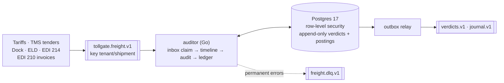

<div align="center">

<a href="https://techmines.github.io/"></a>

# Tollgate

**Freight invoice audit that checks every carrier charge against the contract and against what the trucks actually did.**

[](https://github.com/TECHMINEs/Tollgate/actions/workflows/ci.yml)


**[Live demo](https://techmines.github.io/Tollgate/)** · **[Design document](docs/DESIGN.md)**

</div>

Shippers pay carriers on invoices that arrive days after delivery: linehaul, a fuel surcharge, and accessorial charges such as detention, liftgate and lumper fees. Detention is billed from the carrier's own status messages, which can disagree with the dock's yard system and the truck's ELD geofence. Contract clauses (free time, late-arrival forfeiture, fuel bands) are easy to miss by hand.

Tollgate is a multi-tenant, event-driven audit pipeline. Tariffs, tenders, stop reports from three sources and carrier invoices stream through Redpanda. For each shipment, Tollgate rebuilds what physically happened and rates every invoice line against the pinned tariff version. It then decides to approve, short-pay, reject or hold, weighing whether a dispute is worth its cost, and books the outcome to a double-entry ledger. Each tenant's data is isolated by Postgres row-level security.

> The browser demo runs the real Go engine compiled to WebAssembly. Every shipper, carrier and figure in it is simulated.

---

## What it does

| | |
|---|---|
| **Evidence, not trust** | Rebuilds each stop from dock, ELD and carrier reports. The most trusted source wins, and the carrier's padded departure shows up as a conflict. |
| **Contract-exact rating** | Lane rates and minimums, fuel surcharge bands, detention free time and increments, late-arrival forfeiture, liftgate, stop-off, lumper caps. Integer cents throughout. |
| **Dispute economics** | Disputes only when expected recovery (variance × the tenant's assumed win rate) beats the cost of working the dispute. Smaller overcharges are paid and recorded as leakage. |
| **Self-correcting** | When late telematics change the answer, the verdict gets a new version, the old journal entry is reversed and the new one booked. Nothing is edited in place. |
| **Finance-ready** | Accrues delivered-not-invoiced freight, books approved payables and disputed amounts to suspense accounts, and keeps every journal version balanced. |
| **Multi-tenant** | One platform for many shippers (or an audit firm's clients). Isolation is enforced in the database. |

## Architecture



**At-least-once delivery, exactly-once effects.** Each message is processed in one tenant-scoped transaction:

1. **Inbox claim.** The message's event ID is claimed in the inbox, so a redelivery does nothing.
2. **Rebuild and audit.** The shipment's timeline is rebuilt from the full set of evidence, and every invoice on it is re-audited.
3. **Evidence hash.** Each verdict carries a hash over every input. A new version is written only when that hash changes.
4. **Book and enqueue.** Ledger rebooks and outbound messages are written in the same commit.

Offsets are committed only after the database commits. The [design document](docs/DESIGN.md) covers the hardest problem and how it is tested: the same money from unordered, duplicated, late evidence.

## Tech stack

- **Engine and services:** Go 1.27, franz-go (Kafka client and admin), pgx v5
- **Broker:** Redpanda (Kafka API) with Redpanda Console
- **Database:** PostgreSQL 17 with row-level security, deferred constraint triggers, advisory locks and `SKIP LOCKED`
- **Demo:** Vite, React 19, TypeScript (strict), Tailwind CSS 4, Go compiled to WebAssembly, TECHMINES-Brand theme
- **Quality:** unit tests with the race detector, Postgres integration tests, and a 25-seed answer-key test against the simulator, all in GitHub Actions

## Run it

**Prerequisites:** Go 1.27+, Node.js 20+, and Docker for the full stack.

**1. Engine only, no infrastructure**

```bash
git clone https://github.com/TECHMINEs/Tollgate.git && cd Tollgate
go test ./...
go run ./cmd/tollgate demo                           # simulate, audit and print every verdict
go run ./cmd/tollgate demo --shuffled --dupes 40     # same verdicts in any delivery order
```

**2. Full stack: Postgres, Redpanda, auditor, outbox relay**

```bash
docker compose up -d --build                  # setup job migrates, seeds tenants, creates topics
docker compose run --rm simulate              # produce a synthetic scenario to Redpanda
docker compose logs -f auditor                # verdicts as they are issued
docker compose run --rm report                # per-tenant totals, read through row-level security
open http://localhost:8080                    # Redpanda Console: topics, partitions, consumer lag
make test-integration                         # Postgres tests against the running database
```

**3. Browser demo**

```bash
cd web && npm install && npm run dev          # compiles the engine to WebAssembly first
# http://localhost:5180/Tollgate/
```

The compose file's credentials are local development defaults. In production the auditor connects as `tollgate_app` (no owner rights, no `BYPASSRLS`), and the outbox relay as `tollgate_publisher`.

## The demo

- **Broker stream.** Messages arrive in partition and offset order. Duplicates are visibly dropped by the inbox.
- **Invoice queue.** Filter by decision, search, and export the dispute list as CSV.
- **Shipment drill-down.**
  - The contract clock: appointment, free time and billable detention.
  - Each source's reported arrival and departure, with conflicts flagged.
  - Every invoice line, billed against expected, with the working shown.
  - The append-only verdict history.
- **Carriers.** Billing-accuracy scorecard, and where the overcharged dollars come from.
- **Ledger.** Trial balance of the freight sub-ledger and the journal, including reversals.
- **Policy lab.** Change dispute cost, tolerance, assumed win rates or the evidence rule, then re-run the whole scenario to compare.
- **Replay proof.** The same scenario in four delivery orders, with identical final-state fingerprints.

## Repository layout

```
cmd/tollgate/          CLI: setup, migrate, seed, topics, auditor, outbox, simulate, report, demo
cmd/tollgate-wasm/     WebAssembly bridge for the browser demo
internal/tariff/       contract model and rating (pure)
internal/timeline/     multi-source stop reconstruction (pure, order-independent)
internal/audit/        line findings, dispute economics, evidence hash (pure)
internal/ledger/       double-entry postings, accruals, reversal rebooking
internal/events/       envelope, topics, payloads
internal/pipeline/     processor, Store interface, in-memory store
internal/store/        Postgres store, migrator, outbox relay
internal/broker/       topics, consumer group with DLQ, producer helpers
internal/sim/          deterministic synthetic freight network with an answer key
internal/demo/         view models for the browser demo
migrations/            SQL schema and row-level security policies
web/                   Vite + React demo
docs/DESIGN.md         project selection, business case, architecture, hardest problem
```

## Status

The engine, pipeline, schema, broker wiring and demo are built and tested. Not built yet: an HTTP API for AP systems, the carrier dispute workflow (credit memos and resolving journal entries), X12 EDI parsers, an evidence-window policy for held invoices, and metrics. See [What is not built yet](docs/DESIGN.md#what-is-not-built-yet).

---

<div align="center">

Created by **Pranav Jangid** | [TECHMINES](https://techmines.github.io/)

</div>
