# Tollgate design document

Status: foundation built (engine, pipeline, schema, broker wiring, browser demo). Author: Pranav Jangid.

This document records how the project was chosen, the business problem, the architecture, and the hardest engineering problem with its solution. Anything not yet built is listed under [What is not built yet](#what-is-not-built-yet).

---

## 1. Choosing the project

### Constraints

- Solve an expensive, real B2B operations problem with management logic in it, so the BBA half matters as much as the B.Tech half.
- Use a systems concept not already in the portfolio: multi-tenancy, event-driven architecture on a log broker, real-time collaboration, or complex data pipelines.
- Ship a visual demo that runs in a browser with no paid services.
- Do not overlap the existing five projects:

| Project | What it already covers |
|---|---|
| Relay | Go gateway, Redis Lua rate limits and token quotas, circuit breakers, Prometheus |
| ChainProof | Chain of custody, Postgres/Prisma, Solidity on Polygon, IPFS |
| DevPulse | Developer burnout analytics, React/Express/FastAPI, scikit-learn |
| Nexora | Pre-disaster resilience modelling for industrial facilities |
| AutoLine | Car-plant operations on React/Express, Oracle-dialect SQL |

No CRUD apps, and no AI finance or stock wrappers.

### Five candidates

**1. Usage-based billing and metering engine for SaaS companies.** Ingest usage events, rate them against price plans with tiers, commits and overages, and issue invoices.
*Rejected.* The category is crowded with mature open-source products (Lago, OpenMeter) and funded vendors (Orb, Metronome), so a portfolio version reads as a clone. It also overlaps Relay, which already meters tokens and enforces quotas. The pricing strategy is real business logic, but the person paying for metering is an engineer, so the BBA half stays thin.

**2. Real-time collaborative S&OP planning room (CRDTs over a demand and supply plan).** Sales, operations and finance edit one plan at once and converge on a consensus forecast.
*Rejected.* Collaborative editing over a grid is a spreadsheet clone in the eyes of most reviewers. The interesting logic (how a consensus plan is reached) lives in the planners' heads, not in code, so the business side cannot be demonstrated. Manufacturing planning also sits next to AutoLine.

**3. Cold-chain excursion and liability ledger for pharma and food logistics.** Stream temperature telemetry, detect excursions, and allocate liability across custody legs for claims.
*Rejected.* Custody legs and liability allocation overlap ChainProof's chain of custody almost exactly, and the sensor-pipeline story sits close to Nexora's facility modelling. Credible simulated temperature physics is also hard to make convincing in a demo.

**4. Retail deductions recovery for consumer-goods suppliers.** Retailers deduct from supplier payments for compliance failures (late or short shipments, labelling); suppliers lose the money unless they dispute within a deadline.
*Rejected, narrowly.* The business problem is real and strongly BBA-flavoured. But the documents arrive in daily batches, so the system is mostly document matching plus a workflow queue. That drifts towards CRUD, and the demanded systems concept never becomes necessary. It is also hard to make visual.

**5. Freight invoice audit against contract and physical evidence.** *Chosen.* See below.

### Why freight audit wins

- **It is an existing, paid-for function.** Shippers already pay freight audit and payment firms or run audit teams in accounts payable. The problem does not need to be invented.
- **The business logic is in the code.** Contract tariffs, fuel surcharge tables, detention clauses, dispute economics, carrier scorecards and month-end accruals are management-accounting concepts. They have to be modelled exactly, or the money is wrong.
- **The systems concepts are forced, not decorative.** Evidence arrives from several systems, out of order, duplicated and late, so the system must be event-driven and idempotent. A freight audit firm serves many shippers whose contracts must never mix, so multi-tenancy is the product's shape, not a feature.
- **No overlap.** None of the five projects touches logistics billing, event logs or tenant isolation.
- **It demos well.** A stop timeline with a red detention window and the carrier's padded departure next to the ELD's real one explains the product in five seconds.

---

## 2. The business problem

### Who pays

1. **Shippers with large truckload and LTL spend** (manufacturers, grocers, distributors) and their accounts payable and logistics finance teams.
2. **Freight audit and payment providers and 3PLs** that audit invoices for many shipper clients. For them Tollgate is a multi-tenant platform: every client's tariffs, shipments and invoices stay isolated.

### What it costs them today

A carrier invoice (EDI 210) arrives days or weeks after delivery. It contains the linehaul, a fuel surcharge, and accessorial charges such as detention, liftgate, stop-off and lumper fees. Money leaks in predictable ways:

- **Detention padding.** Detention is billed by the hour after free time. The carrier bills from its own status messages (EDI 214), which can report a later departure than the dock's yard system or the truck's ELD geofence. The shipper rarely has those three sources side by side.
- **Ignored contract clauses.** Many contracts forfeit detention if the truck arrived late for its appointment. A clerk checking the total against a rate sheet does not see this.
- **Fuel table errors.** The surcharge depends on a weekly diesel index and a band table. A one-band error is small per invoice and large across a year.
- **Uncontracted and unsupported charges.** Inside delivery that was never agreed, liftgate that was never requested, lumper fees without a receipt.
- **Duplicates.** The same invoice resent under a new document ID, or a second invoice re-billing the linehaul.
- **Late accruals.** Freight is delivered in one month and invoiced in the next. Finance has to accrue the expected cost at delivery, or the books are wrong at close.
- **Disputing everything costs money too.** Each dispute takes analyst time and carrier goodwill. A policy of disputing every cent loses money on small variances.

Today this is spreadsheets, sampling, or an outsourced audit paid as a share of recoveries. Tollgate does not quote an industry overcharge rate: published figures vary by source and are not verified here. The demo lets the viewer set the error rate and shows what the engine catches.

### Where the BBA and B.Tech halves meet

| Business concept | Where it lives in code |
|---|---|
| Contract tariff: lanes, minimums, fuel bands, detention clause, accessorial schedule | `internal/tariff`, immutable versions in `tariffs` |
| Evidence-based billing verification | `internal/timeline` (multi-source reconstruction) |
| Audit findings and payment decision | `internal/audit` |
| Dispute economics: dispute only when expected recovery exceeds the cost of disputing | `audit.decide`, tenant `Policy` (dispute cost, assumed win rates) |
| Accepted leakage: overcharges paid knowingly because disputing costs more | `Verdict.LeakageCents`, *Overcharge paid knowingly* KPI |
| Month-end freight accrual and its release on invoicing | `ledger.AccrualLines`, journal `accrual:<shipment>` |
| Double-entry suspense accounting for disputes | `ledger.VerdictLines`: 1450 disputes receivable, 2015 AP disputed |
| Corrections by reversal, never by edit | `ledger.Rebook`, append-only `postings` |
| Carrier scorecards for procurement | demo Carriers tab |
| Policy change analysis before rollout | demo Policy lab (`demo.WhatIf`) |

---

## 3. Architecture

```mermaid
flowchart LR
    subgraph Sources["Sources (simulated)"]
        TMS["TMS tenders"]
        Dock["Dock / yard system"]
        ELD["ELD geofence"]
        EDI214["Carrier EDI 214"]
        EDI210["Carrier EDI 210 invoices"]
        Contracts["Contract tariffs"]
    end

    Topic[["tollgate.freight.v1<br/>6 partitions · key tenant/shipment"]]
    DLQ[["tollgate.freight.dlq.v1"]]

    subgraph Auditor["auditor (Go, franz-go consumer group)"]
        Claim["inbox claim"]
        Rebuild["timeline rebuild"]
        Audit["audit + dispute economics"]
        Book["verdict version + ledger rebook + outbox"]
    end

    PG[("Postgres 17<br/>RLS per tenant<br/>append-only verdicts + postings")]
    Relay["outbox relay<br/>SKIP LOCKED batches"]
    Out[["tollgate.verdicts.v1<br/>tollgate.journal.v1"]]
    AP["AP / ERP / dispute workflow"]

    Sources --> Topic --> Claim --> Rebuild --> Audit --> Book
    Claim -. permanent error .-> DLQ
    Book <--> PG
    PG --> Relay --> Out --> AP
```

### Stack

| Layer | Choice | Why |
|---|---|---|
| Engine and services | Go 1.27 | One static binary per role; the same engine compiles to WebAssembly for the demo |
| Broker | Redpanda (Kafka API), franz-go client | Kafka semantics without the JVM or ZooKeeper; single container locally; production can point at any Kafka |
| Database | PostgreSQL 17, pgx v5 | Row-level security, deferred constraint triggers, `SKIP LOCKED`, advisory locks |
| Demo | Vite, React 19, TypeScript (strict), Tailwind 4, Go WebAssembly | Static site on GitHub Pages; no backend to host |
| Brand | TECHMINES-Brand kit | Shared theme, brand bar, footer and the Tollgate mark |
| Local infra | Docker Compose | Postgres, Redpanda, Redpanda Console, setup job, auditor, outbox relay |

### Topics

| Topic | Key | Partitions | Retention | Contents |
|---|---|---|---|---|
| `tollgate.freight.v1` | `tenant/shipment` | 6 | 7 days | tariffs, tenders, stop reports, invoices |
| `tollgate.verdicts.v1` | `tenant/shipment` | 6 | 7 days | every verdict version |
| `tollgate.journal.v1` | `tenant/shipment` | 6 | 7 days | every journal version (balanced postings) |
| `tollgate.freight.dlq.v1` | original key | 1 | 30 days | undecodable or invalid messages, with reason and source offset |

All inbound documents for a shipment share one topic and one key, so the broker delivers them to one consumer in offset order. That avoids concurrent work on a shipment in the normal case. It does **not** give event-time order, and nothing relies on it.

Topics carry a schema version (`.v1`). A breaking change gets a new topic and a dual-write period rather than an in-place change.

### Schema

`migrations/0001_core.sql` and `0002_tenant_isolation.sql`, embedded in the binary and applied by `tollgate migrate` under an advisory lock.

| Table | Key | Notes |
|---|---|---|
| `tenants` | `id` | policy as JSONB; provisioned by an admin, never by an event |
| `inbox` | `(tenant_id, source, event_id)` | idempotent consumer |
| `tariffs` | `(tenant_id, id, version)` | immutable; republishing different terms under the same version is a permanent error |
| `shipments` | `(tenant_id, id)` | tender details; pinned tariff version |
| `stop_events` | `(tenant_id, source, event_id)` | no FK to shipments: evidence may arrive before the tender |
| `invoices` | `(tenant_id, id, revision)` | carrier revisions kept side by side |
| `verdicts` | `(tenant_id, invoice_id, version)` | append-only, with evidence hash |
| `journals` | `(tenant_id, journal_key)` | current head (version and lines) for optimistic rebooking |
| `postings` | `(tenant_id, journal_key, version, line_no)` | append-only; one-sided lines rejected; each version must balance at commit |
| `outbox` | `id`, unique `event_id` | transactional outbox |

Every tenant-owned table leads with `tenant_id`, so indexes and policies are tenant-scoped from the first migration.

### Tenant isolation

Isolation is enforced by Postgres, not by remembering a `WHERE` clause.

- The auditor connects as `tollgate_app`: not the owner, `NOSUPERUSER`, `NOBYPASSRLS`. The integration test asserts this.
- Each transaction begins with `set_config('app.tenant_id', $1, true)`. The `true` makes it transaction-local, so a pooled connection cannot carry one tenant's scope into the next transaction. The test checks this too.
- Every policy is `USING (tenant_id = app_tenant()) WITH CHECK (tenant_id = app_tenant())`. With no tenant set, `app_tenant()` is NULL and the policy matches nothing: the failure mode is *no rows*, never *all rows*.
- `FORCE ROW LEVEL SECURITY` applies the policies to the table owner too, so a migration-role connection used by mistake sees nothing.
- The outbox relay connects as `tollgate_publisher`, which can read the outbox across tenants and update only `published_at`. It cannot read verdicts or postings.
- A payload whose tenant disagrees with its envelope is dead-lettered before any write.

The trade-off is shared tables, not schema- or database-per-tenant. Shared tables keep migrations and connection pools simple at hundreds of tenants. A large tenant can later move to its own database behind the same `Store` interface.

---

## 4. The hardest problem: correct money from unordered, duplicated, late evidence

### The problem

A detention line is only as good as the timestamps behind it. Those come from three systems with different trust and latency:

- the dock's yard system, accurate and immediate, but only at the shipper's own facilities;
- the truck's ELD geofence, independent of the carrier's billing team, but delivered in batches that can lag by hours, or by days when a device syncs late;
- the carrier's EDI 214 messages, always present, and produced by the party sending the bill.

The broker delivers at least once. Messages for a shipment can arrive in any event-time order, and an invoice can arrive before the telematics that disprove it. The system must:

1. reach the **same verdict and the same ledger** regardless of delivery order and redelivery;
2. **correct itself** when late evidence changes the answer, without double-booking;
3. keep a **defensible audit trail** of every intermediate decision.

### The solution

**Order-independent reconstruction.** `timeline.Build` is a pure function of the *set* of events. It sorts them canonically (event time, then ID), drops duplicate IDs, takes the first arrival and the last departure within each source, then picks the most trusted source per transition. Lower-trust sources that disagree by more than the tenant's tolerance are kept as conflicts. A unit test shuffles and duplicates the inputs 200 times and requires identical output.

**Idempotent consumption.** Each message is processed in one tenant-scoped transaction that starts by inserting its `(source, event_id)` into `inbox`. A redelivery conflicts, the handler returns, and the offset is committed. Offsets are committed only after the database commit, so a crash in between causes a redelivery, never a loss.

**Re-audit on every change, record only meaningful ones.** After applying any document, the auditor rebuilds the shipment's timeline and re-audits every invoice on it. Each verdict carries an **evidence hash**: SHA-256 over the shipment, tariff version and load state, policy version, invoice revision, every contributing event ID and every sibling invoice. If the hash equals the latest stored verdict's, nothing is written. If it differs, a new verdict version is appended.

**Accounting-style corrections.** When a verdict or accrual changes, `ledger.Rebook` writes one new journal version that reverses every line of the previous version and books the new lines. A deferred constraint trigger checks that each journal version balances at commit, and postings cannot be updated or deleted. Net balances always equal the latest version alone, and the trail shows every correction.

**Per-shipment serialisation.** Partitioning keeps a shipment on one consumer, but a rebalance can briefly hand a partition to a second consumer while the first is still working. Each transaction therefore takes `pg_advisory_xact_lock(hash(tenant/shipment))` before touching the shipment. An advisory lock works even when the shipment row does not exist yet. The journal head is also advanced with an optimistic version check, so a lost race fails the transaction and retries rather than double-booking.

**Transactional outbox.** Verdict and journal messages are inserted into `outbox` in the same transaction. A separate relay publishes them in `SKIP LOCKED` batches and marks them sent only after the broker acknowledges. A crash between publish and mark re-sends the batch; downstream consumers deduplicate by the deterministic event ID (`verdict:<tenant>:<invoice>:v<n>`).

**Error classes.** Invalid envelopes, unknown tenants, edits to published tariff versions and cross-tenant payloads are permanent: they go to the DLQ with the reason and source offset, and the partition moves on. Database and network errors are transient: the record is retried with capped exponential backoff and the partition waits, which keeps per-shipment processing in order.

### How it is proven

| Property | Test |
|---|---|
| Timeline independent of order and duplicates | `timeline.TestBuildIgnoresOrderAndDuplicates` |
| Final verdicts and ledger balances identical across broker order, full shuffle, and 40% redelivery | `pipeline.TestOrderAndRedeliveryDoNotChangeTheOutcome` |
| Full replay is a no-op | `pipeline.TestReplayIsANoOp` |
| Every injected error caught, no clean invoice flagged, across 25 seeds | `pipeline.TestAnswerKeyAcrossSeeds` |
| Trial balance always zero | `pipeline.TestLedgerAlwaysBalances` |
| A failed transaction leaves no inbox claim | `pipeline.TestFailedMessageLeavesNoTrace` |
| Postgres and the in-memory store reach identical verdicts | `store.TestPostgresMatchesMemory` |
| RLS: no rows without a tenant, no cross-tenant reads or writes, no scope leak across pooled transactions | `store.TestRowLevelSecurity` |
| Ledger append-only; unbalanced journal rejected at commit | `store.TestLedgerIsAppendOnlyAndBalanced` |
| Outbox replay adds nothing; failed publish leaves rows pending | `store.TestReplayAndOutboxRelay` |

The demo's **Replay proof** tab runs the same check live: four delivery orders, one fingerprint over every final evidence hash and ledger balance.

### Known limits of the approach

- **Re-audit cost grows with evidence per shipment.** Every document triggers a full rebuild for its shipment. Shipments have tens of events, so this is cheap. If it ever is not, the timeline can be cached keyed by the evidence hash.
- **A held invoice waits for evidence indefinitely.** There is no evidence deadline yet. A real deployment needs an "evidence window" policy (for example, release with carrier-only evidence after N days) and a human release action.
- **Outbox ordering across relay replicas.** One relay instance preserves per-key order. Several instances with `SKIP LOCKED` can reorder messages for the same key across batches; scaling the relay needs key-hash sharding or a leader.
- **Retrying a transient error blocks its partition.** That is deliberate for ordering, but a stuck database stalls ingestion. Consumer lag alerting is required.

---

## 5. Demo with no paid services

- **GitHub Pages, static.** `web/` builds to static files. The Go engine and the in-memory store compile to WebAssembly (`cmd/tollgate-wasm`, about 1.4 MB gzipped), so the demo runs the real audit, ledger and pipeline code, not a JavaScript imitation.
- **Deterministic simulator.** `internal/sim` generates two fictional shippers, three fictional carriers, tariffs, shipments, multi-source stop events with realistic reporting delays, and invoices with known injected errors. The same seed always gives the same world, and its answer key drives both the tests and the demo's detection panel.
- **Everything local.** `docker compose up` runs Postgres, Redpanda, Redpanda Console, the auditor and the outbox relay. `tollgate simulate` produces a scenario, and `tollgate report` reads per-tenant totals through RLS.
- **No figures are invented.** Every number in the demo is computed by the engine from simulated data. Win rates and dispute cost are tenant policy inputs, labelled as assumptions.

---

## What is not built yet

- HTTP API for AP systems (submit invoices, query verdicts, release holds) with per-tenant authentication.
- Dispute workflow: carrier responses, credit memos, and the resolving journal entries (1450 against 2015).
- EDI X12 210/214 parsers; the scaffold uses JSON envelopes with the same fields.
- Evidence-window policy and manual hold release.
- Prometheus metrics (consumer lag, verdict latency, DLQ rate) and a Grafana board.
- Invoice revisions in the simulator (the engine already supports them).
